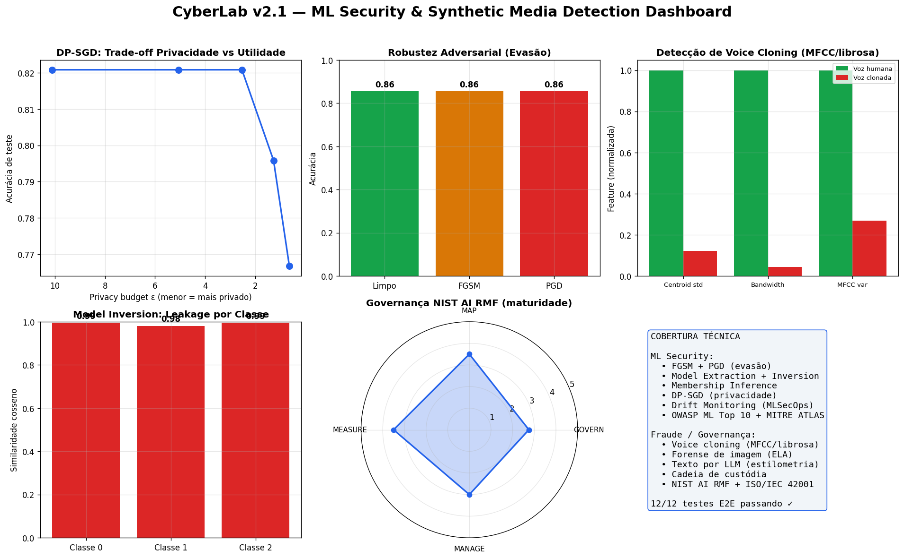

# 🛡️ CyberLab — Laboratório de Segurança Ofensiva e Defensiva para IA e Nuvem

### Python 3.10 · PyTorch · FastAPI · Terraform · Checkov · Trivy · Pytest · Ruff

-passing-0a8a0a)

## Status

🟡 **Em desenvolvimento — v2.4.0-dev (módulo `cloud_security`)**

O núcleo adversarial ML / MLSecOps (v2.0–v2.3) está concluído no seu escopo. Nesta revisão foram
reconfirmados de verdade: **29/29** testes em `pytest tests/` (10 testes do upgrade do core + 19 do
novo módulo `cloud_security`, executados nesta sessão em 274,57s) e **20/20** na suíte E2E histórica
(`scripts/test_e2e_ml_security.py`, reexecutada nesta sessão). O módulo `cloud_security` (CSPM
educacional) adicionado na v2.4.0-dev está funcional para **Checkov** e **Trivy** (scan estático real,
sem credencial cloud, **104 findings reais**, **19/19 testes** confirmados em execução isolada desta
sessão — 334,50s, incluindo as chamadas reais aos dois binários). As outras três ferramentas do escopo
original do item de auditoria — **Prowler**, **ScoutSuite** e **Steampipe** — **não foram executadas**
nesta sessão (ver [⚠️ Limitações](#️-limitações)); nenhum resultado deste módulo usa essas três
ferramentas.

---

## Descrição / Contexto

O CyberLab é um laboratório aplicado de segurança para sistemas de Machine Learning e, a partir desta
versão, também para infraestrutura cloud como código. Nasceu como ambiente de cibersegurança ofensiva
e defensiva clássica e evoluiu para cobrir o ciclo completo de proteção de modelos: ameaças aos dados
de treinamento, evasão em inferência, extração, vazamento de privacidade, monitoramento operacional e
resposta a incidentes — e agora também detecção de más configurações de IaC (Terraform) em AWS, Azure
e GCP, com mapeamento declarativo para frameworks de controle reais.

> Todo o conteúdo é destinado a estudo e execução controlada: dados sintéticos, ambientes isolados, e
> labs Terraform que nunca são aplicados (`terraform apply`) contra uma conta cloud real.

## 🧭 Origem do Projeto

1. **v1.0 (2026-04-09)** — laboratório clássico de pentest (reconhecimento, brute force, malware
   simulado) em ambiente isolado (VirtualBox, Host-Only), sem acesso a sistemas reais.
2. **v2.0 (2026-09-16)** — mudança de rumo motivada pela constatação de que modelos de IA passaram a
   ser alvo de ataques especializados: o projeto passa a cobrir ML Security e forense digital com IA
   (poisoning, deepfake, voice cloning).
3. **v2.1 → v2.3 (2026-09-16 → 2026-10-05)** — consolidação do núcleo adversarial: primeiro com
   implementações didáticas (algumas incorretamente descritas como white-box, corrigido depois),
   depois com FGSM/PGD white-box reais via autograd PyTorch, taxonomia black-box completa, auditoria
   de gradient masking, API de inferência endurecida e pipeline MLSecOps com resposta a incidente.
4. **v2.4.0-dev (2026-10-07)** — item #5 de uma auditoria de portfólio ("Cyber / AI Security / Cloud
   Security") identificou a ausência de um módulo de Cloud Security Posture Management (CSPM). Decisão
   tomada nesta sessão: construir labs Terraform propositalmente mal configurados para as 3 clouds
   principais, rodar scanners estáticos reais (Checkov, Trivy) contra eles sem nenhuma credencial
   cloud, mapear os findings reais para NIST CSF 2.0 / ISO 27001:2022 / LGPD, e documentar com rigor
   as ferramentas do escopo original que não puderam ser executadas (Prowler — conflito de dependência
   real; ScoutSuite e Steampipe — exigem credencial de conta cloud real, indisponível neste ambiente).

## 🎯 Objetivo

- Demonstrar ataques adversariais white-box e black-box com gradientes/queries reais, não simulados.
- Auditar falsa robustez (gradient masking) combinando múltiplos sinais independentes.
- Operar um pipeline MLSecOps com detecção de drift, política de resposta (allow/challenge/
  fallback/quarantine) e rollback auditável.
- Expor uma API de inferência com autenticação, rate limiting e minimização de output.
- Detectar más configurações reais de infraestrutura como código em 3 clouds via scanners estáticos,
  sem depender de credencial cloud real.
- Mapear findings reais para controles reconhecidos (NIST CSF 2.0, ISO/IEC 27001:2022, LGPD) sem
  inventar cobertura para o que não tem categoria conhecida.

## 🔬 Linha de Pesquisa / Desenvolvimento

- Adversarial Machine Learning (evasão, extração de modelo, ataques de privacidade, poisoning).
- MLSecOps (monitoramento operacional, política de risco, resposta a incidente de modelo).
- Mídia sintética e forense digital (deepfake de vídeo, voice cloning, phishing gerado por IA).
- Governança de IA (NIST AI RMF, ISO/IEC 42001, classificação de risco por EU AI Act).
- **Cloud Security Posture Management** — scan de IaC e mapeamento de compliance (novo na v2.4.0-dev).

## 🏗️ Arquitetura

### Núcleo adversarial / MLSecOps

~~~text
DATA / REQUEST
      |
      v
SCHEMA + RANGE VALIDATION
      |
      v
AUTH + QUERY BUDGET + RATE LIMIT
      |
      v
ADVERSARIAL / DRIFT / EXTRACTION SIGNALS
      |
      v
RISK CORRELATION + POLICY
      |
      +-----------+------------+-------------+
      |           |            |             |
    ALLOW      CHALLENGE    FALLBACK     QUARANTINE
      |                                      |
      v                                      v
  INFERENCE                              INCIDENT
      |                                      |
      v                                      v
MINIMIZED OUTPUT                      ROLLBACK / RESTORE
      |
      v
HASHED TELEMETRY + AUDIT
~~~

### `cloud_security` — CSPM educacional (novo na v2.4.0-dev)

~~~text
TERRAFORM (lab mal configurado, nunca aplicado)
   AWS main.tf · Azure main.tf · GCP main.tf
                |
                v
   CHECKOV 3.2.459 (scan estático)     TRIVY 0.75.0 `config` (scan estático)
                |                                |
                +----------------+---------------+
                                 v
                  FINDINGS REAIS (JSON versionado em results/)
                                 |
                                 v
         MAPEAMENTO DECLARATIVO (check_id/ID -> categoria de misconfig)
                                 |
                                 v
      CONTROLES REAIS: NIST CSF 2.0 · ISO/IEC 27001:2022 Anexo A · LGPD
                                 |
                                 v
              RELATÓRIO CONSOLIDADO (mapped_findings.json)
~~~

O CLI, os módulos Python e a API constituem a fonte de verdade. Os notebooks apenas orquestram essas
APIs para ensino e reprodução dos experimentos.

| Módulo | Função | Teste |
|---|---|---|
| `scripts/python/ml_security/` | Ataques, defesas e benchmarks adversariais | `scripts/test_e2e_ml_security.py` |
| `services/model_api/` | API FastAPI endurecida | testes de aceitação em `tests/` |
| `cloud_security/mapping/` | Parsing e mapeamento declarativo de findings reais | `tests/cloud_security/test_map_findings_report.py`, `test_framework_mapping.py` |
| `cloud_security/labs/` | IaC propositalmente mal configurado (nunca aplicado) | `tests/cloud_security/test_lab_misconfig_detection.py` |

## ⚙️ Funcionamento

1. Os 3 labs Terraform (`cloud_security/labs/{aws,azure,gcp}/main.tf`) descrevem recursos
   propositalmente abertos — S3/Storage/GCS público, Security Group/NSG/firewall com `0.0.0.0/0`,
   IAM/role com `Action: "*"` ou `roles/owner`, RDS/Key Vault sem criptografia/soft-delete.
2. Checkov e Trivy rodam localmente contra cada lab (`checkov -d ...`, `trivy config ...`), sem
   nenhuma chamada de API para AWS/Azure/GCP e sem qualquer credencial cloud.
3. Os outputs brutos de ambas as ferramentas são versionados em `cloud_security/results/*.json`.
4. `cloud_security/mapping/map_findings.py` consolida os dois outputs, categoriza cada finding pelo
   `check_id` (Checkov) ou `ID` (Trivy) e aplica o mapeamento declarativo para NIST CSF 2.0, ISO/IEC
   27001:2022 e LGPD.
5. Findings sem categoria conhecida permanecem no relatório com `mapped: false` e controles vazios —
   nunca recebem um controle "adivinhado".
6. `tests/cloud_security/test_lab_misconfig_detection.py` roda os scanners de novo via `subprocess` a
   cada execução de teste: é um teste de regressão — se alguém corrigir/remover um misconfig
   proposital do Terraform do lab, o check correspondente some dos resultados e o teste falha
   apontando exatamente qual.

Fluxo ponta a ponta do núcleo adversarial (inalterado desde a v2.3):

~~~text
Request → validação de schema → autenticação/rate limit → sinais adversariais/drift/extração
→ correlação de risco → política (allow/challenge/fallback/quarantine) → inferência ou incidente
→ output minimizado → telemetria com hash → auditoria
~~~

## 🧠 Verificação / Modelagem

| Camada | O que prova | Resultado |
|---|---|---|
| Auditoria de gradient masking | FGSM × PGD, curva de epsilon, curva de steps, restarts, transferência e black-box — convergência de sinais independentes, não um único ataque | ver [`docs/10_gradient_masking.md`](docs/10_gradient_masking.md) |
| Regressão de misconfig (Checkov/Trivy) | Os scanners reais continuam detectando os 11 checks propositais usados como sentinela (5 AWS + 3 Azure + 3 GCP no Checkov; 4+2+2 no Trivy) | 19/19 testes de `tests/cloud_security/` passando, confirmado nesta revisão (334,50s, inclui as chamadas reais aos binários) |
| Consistência do relatório mapeado | `total_findings == mapped + unmapped == len(findings)`; nenhum controle inventado para check desconhecido | `test_build_report_is_internally_consistent`, `test_map_finding_preserves_unmapped_finding_without_inventing_controls` |

A auditoria de gradient masking não declara um modelo robusto porque um ataque falhou — ela agrega
sinais independentes e registra quando BPDA ou EOT seriam necessários.

## 🧪 Desenvolvimento Experimental

Fluxo: implementar → rodar contra o lab real → testar → documentar o que não funcionou.

**Achados reais (não plantados):**

1. **Bug histórico (v2.1 → v2.3):** FGSM/PGD eram descritos como white-box, mas a implementação
   original usava diferenças finitas (gradiente estimado, não real). Corrigido com autograd PyTorch
   real; a correção está registrada no `CHANGELOG.md` como mudança de comportamento, não como feature
   nova.
2. **Bug no E2E histórico:** o path de import apontava para `scripts/` em vez de `scripts/python/` —
   os 20 testes da suíte nunca rodavam de fato antes da correção.
3. **Bug no detector de drift:** a métrica MAPE dividia por uma média próxima de zero em dados
   centrados, gerando falso positivo sistemático; substituída por effect size padronizado.
4. **Incidente real nesta sessão (v2.4.0-dev):** a tentativa de instalar `prowler-cloud` 5.44.0 no
   Python 3.10 canônico (compartilhado com outros projetos do usuário) causou um conflito real de
   dependências — o resolver do pip fez upgrade parcial de `botocore`/`s3transfer` perseguindo os
   requisitos do Prowler, não concluiu a instalação do pacote, e deixou o próprio Checkov
   temporariamente quebrado (`ImportError: cannot import name 'DocumentModifiedShape'` ao importar
   `boto3`/`botocore`). O ambiente foi restaurado fixando `botocore>=1.43.74,<1.44.0` e
   `s3transfer>=0.19.0,<0.20.0`, e o Checkov foi revalidado comparando o output byte a byte com o
   rodado antes do incidente. Dado o risco real já demonstrado, a instalação do Prowler **não foi
   retentada** nesta sessão.

## 🛠️ Tecnologias

- **Linguagens:** Python 3.10
- **Frameworks:** PyTorch (núcleo adversarial), FastAPI · Pydantic · Uvicorn (API endurecida),
  scikit-learn · NumPy · SciPy (ML security didático)
- **Segurança / Cloud:** Terraform (labs IaC, nunca aplicado), Checkov 3.2.459, Trivy 0.75.0
  (`trivy config`)
- **Avaliadas e não usadas nesta versão:** Prowler (`prowler-cloud` 5.44.0 — conflito de dependência
  real), ScoutSuite e Steampipe (ambos exigem credencial de conta cloud real)
- **Análise / Qualidade:** Pytest, Ruff, `compileall`
- **Visualização:** Matplotlib, Seaborn, Plotly
- **Opcionais do núcleo adversarial:** ART (Adversarial Robustness Toolbox), Foolbox, Evidently,
  whylogs (dependências opcionais, documentadas como indisponíveis quando não instaladas, sem simular
  paridade)

## 📊 Resultados

### Núcleo adversarial — benchmark reproduzível

Mesmo modelo e mesmo conjunto de dados para a implementação própria; validado localmente (v2.3):

| Métrica | Valor |
|---|---:|
| Clean accuracy | 1.00 |
| Robust accuracy | 0.25 |
| Attack success rate | 0.75 |
| L2 médio | 0.4243 |
| L∞ médio | 0.3000 |

ART e Foolbox são dependências opcionais; quando não instaladas, o relatório registra explicitamente
a indisponibilidade em vez de simular paridade.

### `cloud_security` — resultados reais (v2.4.0-dev)

A partir de `cloud_security/results/mapped_findings.json`, gerado rodando Checkov e Trivy de verdade:

| Métrica | Valor |
|---|---:|
| Findings reais coletados (Checkov + Trivy, 3 clouds) | 104 |
| — AWS | 56 |
| — Azure | 30 |
| — GCP | 18 |
| Mapeados para pelo menos um controle de cada framework | 90 |
| Sem categoria conhecida (preservados sem controle inventado) | 14 |

Categorias mais frequentes: exposição pública de storage (21), rede aberta ao mundo em
`0.0.0.0/0` (17), governança de ciclo de vida de recursos (15), IAM/role superprivilegiado (11),
dados em repouso sem criptografia (12).

### Validação local (confirmada nesta revisão)

| Verificação | Resultado |
|---|---|
| `pytest tests/` (10 upgrade + 19 cloud_security) | 29/29 passando — 274,57s |
| `pytest tests/cloud_security/` isolado (inclui chamadas reais a Checkov/Trivy) | 19/19 passando — 334,50s |
| `python scripts/test_e2e_ml_security.py` | 20/20 passando |
| Ruff em `cloud_security/` | Aprovado, sem findings |
| Ruff em `tests/cloud_security/` | 1 import não usado (`sys` em `test_lab_misconfig_detection.py`), não corrigido nesta revisão — fora do escopo (só o README foi alterado) |

## 🖼️ Evidências

  

Dashboard consolidado do núcleo de ML Security (v2.1).

  

Benchmark from-scratch × ART × Foolbox.

  
  

Error Level Analysis: imagem adulterada vs. imagem limpa.

O módulo `cloud_security` não tem evidência visual nesta versão — os resultados são JSON estruturado
(`cloud_security/results/`), não há dashboard/imagem gerado para ele ainda.

## 🚀 Aplicações

- Treinamento e portfólio em red-teaming de modelos de Machine Learning.
- Triagem inicial de GRC/compliance sobre labs de IaC (acelera, mas não substitui auditoria formal).
- Material didático para MLSecOps, auditoria de gradient masking e CSPM.

## 🔭 Visão de Longo Prazo

~~~text
Laboratório educacional de pentest clássico
            ↓
Núcleo de segurança adversarial de ML (ataque, defesa, operação)
            ↓
Cobertura de postura de segurança de infraestrutura cloud (CSPM)
            ↓
Integração de gates de segurança em CI/CD + policy engine + evidence pack
~~~

## 🗺️ Roadmap

**F0 — Laboratório clássico (v1.0)** ✅ Concluída — 10 notebooks, scanner/brute force/log analyzer,
simulação segura de ransomware/keylogger.

**F1 — Núcleo adversarial e MLSecOps (v2.0–v2.3)** ✅ Concluída — FGSM/PGD white-box reais, taxonomia
black-box, auditoria de gradient masking, API endurecida, incident response; evidência: 29/29 testes
`pytest tests/` + 20/20 E2E, ambos confirmados nesta revisão.

**F2 — Cloud Security / CSPM (v2.4.0-dev)** 🟡 Parcial — labs IaC + Checkov/Trivy reais + mapeamento
NIST/ISO/LGPD concluídos (104 findings, 90 mapeados, 19/19 testes); Prowler, ScoutSuite e Steampipe
permanecem pendentes por conflito de dependência e falta de credencial cloud real.

**F3 — Laboratório avançado (v2.5)** ⏳ Planejada — Opacus e privacy/utility benchmark, AutoAttack e
RobustBench, MLaaS threat lab, retomada de Prowler/ScoutSuite/Steampipe quando viável.

## 🕓 Histórico e Mudanças

| Versão | Data | O que mudou |
|---|---|---|
| 2.4.0-dev | 2026-10-07 | `cloud_security/`: labs IaC mal configurados, scan real Checkov/Trivy (104 findings), mapeamento NIST/ISO/LGPD, 19 testes novos; Prowler/ScoutSuite/Steampipe documentados como não executados |
| 2.3.0-dev | 2026-10-05 | FGSM/PGD white-box reais (PyTorch), black-box por threat model, auditoria de gradient masking, API endurecida, pipeline MLSecOps |
| 2.2.0 | 2026-09-16 | 7 novos módulos (clean-label poisoning, transferability, watermarking, antispoofing, deepfake de vídeo, phishing detector, antifraude), suíte E2E ampliada para 20 testes |
| 2.1.0 | 2026-09-16 | ML Security completo e testado: DP-SGD, model inversion, FGSM/PGD, detectores de voice cloning e forense de imagem, dashboard |
| 2.0.0 | 2026-09-16 | Nova linha: ML Security e Adversarial ML, mídia sintética, MITRE ATLAS |
| 1.0.0 | 2026-04-09 | Estrutura base do laboratório clássico de cibersegurança |

Ver [CHANGELOG.md](CHANGELOG.md) para o detalhamento completo de cada versão.

## 🔮 Próximos Passos

**Concluído nesta versão:**
- ✅ Labs Terraform para 3 clouds, scan real com Checkov e Trivy, mapeamento declarativo para
  NIST CSF 2.0 / ISO 27001:2022 / LGPD, 19 testes novos.

**Depende de terceiros / ambiente:**
- Credencial de conta cloud real para rodar ScoutSuite e Steampipe (ambos coletam estado via API,
  não têm modo de scan estático de Terraform local).
- Um ambiente Python isolado (não o canônico compartilhado) para reavaliar a instalação do Prowler
  sem risco de repetir o conflito de dependência já demonstrado.

**Próximos técnicos (o que faria numa v2.5):**
- Policy engine (OPA/Cedar) e aprovação humana para ações críticas.
- Gates de segurança de CI/CD consumindo os findings de `cloud_security`.
- Model registry, proveniência, SBOM e ML-BOM.
- Execução GPU/CUDA e serving distribuído com rate limiter compartilhado.

## ▶️ Como rodar localmente

Recomendado: Python 3.10.

~~~powershell
git clone https://github.com/Yuri-Fernando/CyberLab.git
cd CyberLab

py -3.10 -m pip install -r requirements.txt
py -3.10 -m pytest tests -q
py -3.10 scripts/test_e2e_ml_security.py
~~~

Dependências opcionais do núcleo adversarial:

~~~powershell
py -3.10 -m pip install -r requirements-adversarial.txt
py -3.10 -m pip install -r requirements-observability.txt
~~~

Reproduzir o módulo `cloud_security` (requer os binários `checkov` e `trivy` instalados; nenhuma
credencial cloud é necessária):

~~~bash
checkov -d cloud_security/labs/aws -o json --compact
checkov -d cloud_security/labs/azure -o json --compact
checkov -d cloud_security/labs/gcp -o json --compact

trivy config --format json cloud_security/labs/aws
trivy config --format json cloud_security/labs/azure
trivy config --format json cloud_security/labs/gcp

python -m cloud_security.mapping.map_findings
py -3.10 -m pytest tests/cloud_security -v
~~~

Todos os comandos acima (instalação, suíte `pytest tests`, E2E histórico e a suíte isolada de
`cloud_security`) foram executados nesta revisão do README.

## 📁 Estrutura do repositório

~~~text
CyberLab/
├── scripts/
│   ├── python/
│   │   ├── ml_security/       # ataques, defesas e benchmarks adversariais
│   │   ├── synthetic_media/   # voz, imagem, vídeo, texto e forense
│   │   ├── governance/        # NIST AI RMF, ISO 42001 e antifraude
│   │   └── malware/           # simulações educacionais controladas
│   ├── test_e2e_ml_security.py
│   └── generate_upgrade_scorecard.py
├── services/
│   └── model_api/             # API FastAPI endurecida
├── cloud_security/            # CSPM educacional (novo na v2.4.0-dev)
│   ├── labs/                  # Terraform mal configurado (nunca aplicado)
│   ├── mapping/                # parsing + mapeamento declarativo
│   ├── results/                # outputs reais de Checkov/Trivy + relatório mapeado
│   └── README.md               # detalhe do que rodou e do que não rodou
├── tests/                      # testes determinísticos do upgrade + cloud_security/
├── notebooks/                   # trilha clássica + laboratórios 11–15
├── docs/                        # threat models, matrizes e arquitetura
├── results/                     # dashboards versionados; demais outputs ignorados
├── requirements.txt
├── requirements-adversarial.txt
└── requirements-observability.txt
~~~

## 📚 Documentação

| Documento | Conteúdo |
|---|---|
| [Fundamentos](docs/00_fundamentals.md) | Diferença entre GAN e Adversarial ML |
| [Threat model](docs/04_ml_security_threat_model.md) | MITRE ATLAS aplicado ao pipeline |
| [OWASP ML Security](docs/07_owasp_ml_security_top10.md) | Riscos e controles |
| [Matriz adversarial](docs/08_adversarial_ml_attack_matrix.md) | Poisoning, backdoor e clean-label |
| [Benchmark](docs/09_framework_benchmark.md) | Comparação from scratch, ART e Foolbox |
| [Gradient masking](docs/10_gradient_masking.md) | Checks de falsa robustez |
| [Arquitetura MLSecOps](docs/11_mlsecops_architecture.md) | Serving, policy, incidentes e rollback |
| [ATLAS × OWASP](docs/14_atlas_owasp_crosswalk.md) | Crosswalk de TTPs, riscos e controles |
| [cloud_security/README.md](cloud_security/README.md) | O que rodou de verdade, o que não rodou e como reproduzir |

## ⚠️ Limitações

Ainda não foram validados neste ambiente:

- paridade executável com ART e Foolbox;
- adapters Evidently e whylogs;
- DP-SGD via Opacus;
- execução GPU/CUDA;
- serving distribuído e rate limiter compartilhado;
- Docker, Prometheus/Grafana e cloud MLaaS;
- model registry, assinaturas, proveniência e ML-BOM;
- policy engines OPA/Cedar e aprovação humana para ações críticas.

**Limitações reais do módulo `cloud_security` (documentadas, não fingidas):**

- **Prowler**: a tentativa de instalar `prowler-cloud` 5.44.0 causou um conflito real de dependências
  neste ambiente Python compartilhado (upgrade parcial de `botocore`/`s3transfer` que quebrou
  temporariamente o Checkov). O ambiente foi restaurado e a instalação do Prowler foi abandonada —
  Prowler **não é usado** em nenhum resultado deste módulo.
- **ScoutSuite** e **Steampipe**: ambos dependem de credenciais de conta cloud real para coletar
  estado via API; sem conta real disponível, nenhum dos dois foi instalado ou usado.
- O mapeamento para NIST CSF 2.0 / ISO/IEC 27001:2022 / LGPD é **declarativo e educacional** — acelera
  a triagem de um analista de GRC, mas **não é uma certificação, auditoria formal ou atestado de
  conformidade**. Qualquer afirmação de conformidade real exige revisão humana, evidências adicionais
  e, no caso de ISO 27001, um processo de certificação formal por organismo acreditado.
- `tests/cloud_security/test_lab_misconfig_detection.py` tem 1 import não usado (`sys`) apontado pelo
  Ruff, não corrigido nesta revisão porque o escopo desta tarefa foi apenas o README.

Esses itens permanecem no roadmap e não são apresentados como capacidades concluídas.

## Status

🟡 **Em desenvolvimento — v2.4.0-dev.** Núcleo adversarial/MLSecOps concluído no seu escopo (29/29 +
20/20 testes confirmados nesta revisão). Módulo `cloud_security` funcional para Checkov/Trivy (104
findings reais, 90 mapeados, 19/19 testes); Prowler/ScoutSuite/Steampipe pendentes por limitação real
de ambiente/credencial, documentados como tal.

## Contexto / Observações

Este é um projeto de portfólio pessoal de Yuri Fernando Dubbern — não afiliado a nenhuma empresa,
cliente ou produto comercial. Todas as métricas citadas foram medidas localmente nesta máquina (testes
automatizados, scanners reais contra labs isolados) e não são estimativas de terceiros nem projeções.
O mapeamento para frameworks de compliance é educacional e declarativo, nunca uma certificação.

## 🔗 Projetos Relacionados

Este repositório faz parte do portfólio público de Yuri Fernando Dubbern
([github.com/Yuri-Fernando](https://github.com/Yuri-Fernando)). Não há dependência de código entre os
repositórios do portfólio — cada um documenta seu próprio escopo, resultados e limitações de forma
independente.

## 🤖 Autor

**Yuri Fernando Dubbern**

Engenharia Elétrica · Ciência da Computação · Inteligência Artificial ·
Sistemas Embarcados · Projeto de Hardware · Pesquisa e Desenvolvimento

[LinkedIn](https://www.linkedin.com/in/yuridubbern) · [GitHub](https://github.com/Yuri-Fernando) · [Lattes](http://lattes.cnpq.br/7151392692642166) · [Linktree](https://linktr.ee/yuri.f.dubbern)

## Licença

Este repositório não contém um arquivo `LICENSE` nesta revisão. Todo o conteúdo é apresentado para
fins educacionais e de portfólio (ver aviso em [Status](#status) e [Contexto / Observações](#contexto--observações)).
